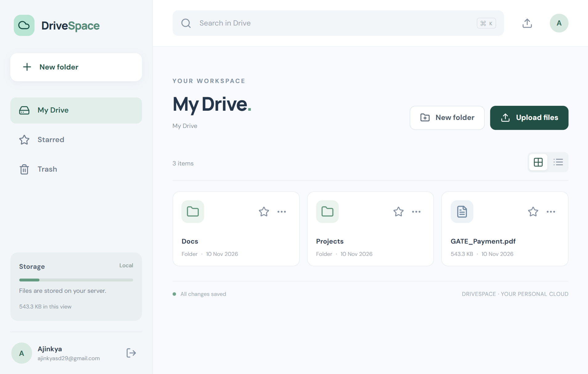
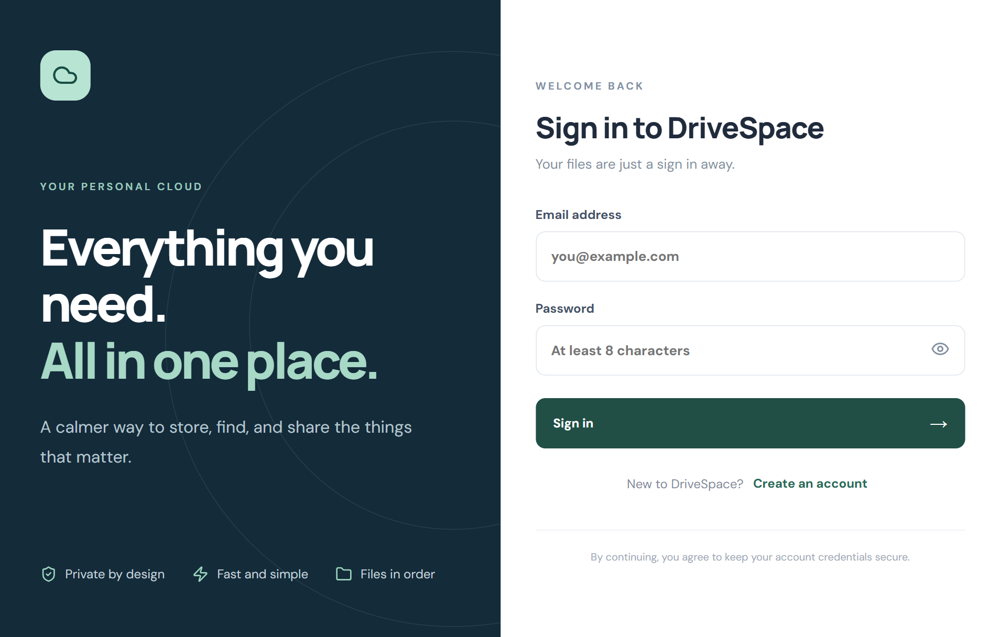

# ☁️ DriveSpace – MERN File Storage App

<p align="center">
  
  
  
  
  
  
  
</p>

<p align="center">
  A full-stack cloud storage application inspired by Google Drive, built using the MERN stack. Upload, organize, manage, and share your files securely through a clean and responsive interface.
</p>

---

## 📸 Screenshots

<!-- Add your project screenshots inside a screenshots folder -->

### Dashboard



### Login Page



---

## ✨ Features

- 🔐 **User Authentication** – Secure registration and login using JWT and bcrypt.
- 📤 **File Upload** – Upload files to your personal cloud storage.
- 📥 **File Download** – Download stored files whenever needed.
- 📁 **Folder Management** – Create, browse, and organize folders.
- 📂 **Nested Folders** – Organize files using a hierarchical folder structure.
- 🔍 **Search** – Search for files and folders.
- ⭐ **Starred Items** – Mark important files and folders as favorites.
- 🔗 **File Sharing** – Generate public sharing links for files.
- 🗑️ **Trash Management** – Move files to trash, restore them, or permanently delete them.
- ✏️ **Rename Files** – Rename files and folders.
- 📋 **Grid & List Views** – Switch between different file display layouts.
- 📱 **Responsive Design** – Works across desktop, tablet, and mobile devices.

## 🛠️ Tech Stack

**Frontend**

- React.js
- JavaScript (ES6+)
- Tailwind CSS
- Vite

**Backend**

- Node.js
- Express.js
- REST API
- JWT Authentication
- bcrypt

**Database**

- MongoDB
- Mongoose

**Development Tools**

- Git & GitHub
- npm
- VS Code

## 📂 Project Structure

```text
mern-drive-clone/
│
├── client/
│   ├── public/
│   └── src/
│       ├── components/
│       ├── pages/
│       ├── context/
│       ├── hooks/
│       ├── services/
│       └── App.jsx
│
├── server/
│   ├── config/
│   ├── controllers/
│   ├── middleware/
│   ├── models/
│   ├── routes/
│   ├── uploads/
│   └── server.js
│
├── package.json
└── README.md
```

## ⚙️ Installation & Setup

### 1. Clone the repository

```bash
git clone https://github.com/ajinkya029/mern-drive-clone.git
```

### 2. Navigate to the project directory

```bash
cd mern-drive-clone
```

### 3. Install dependencies

```bash
npm run install:all
```

### 4. Configure environment variables

Create a `.env` file inside the `server` directory using the provided `.env.example` file.

```env
PORT=5000
MONGODB_URI=mongodb://127.0.0.1:27017/mern-drive
JWT_SECRET=your_secret_key
```

Use the actual environment variable names from the supplied `.env.example` file.

### 5. Start the application

```bash
npm run dev
```

### 6. Open in your browser

```text
http://localhost:5173
```

## 🔑 Authentication

The application uses JWT-based authentication.

- Users can register and log in.
- Passwords are hashed using bcrypt.
- Protected routes require a valid authentication token.
- User-specific files and folders are managed through authenticated API requests.

## 🔌 API Overview

The backend provides REST API endpoints for:

| Module         | Operations                        |
| -------------- | --------------------------------- |
| Authentication | Register, Login, Get Profile      |
| Files          | Upload, Download, Rename, Delete  |
| Folders        | Create, Browse, Rename            |
| Search         | Search Files and Folders          |
| Starred        | Add and Remove Favorites          |
| Trash          | View, Restore, Permanently Delete |
| Sharing        | Generate and Access Public Links  |

## 📷 Adding Screenshots

Create a `screenshots` folder in the project root:

```text
mern-drive-clone/
└── screenshots/
    ├── dashboard.png
    ├── files.png
    ├── folders.png
    └── login.png
```

Take screenshots of your running application and save them using the filenames above.

GitHub will automatically display the screenshots through the Markdown image paths used in this README.

## 🚀 Future Improvements

- Cloud storage integration using AWS S3 or Cloudinary.
- File previews for images, PDFs, and documents.
- Drag-and-drop file uploads.
- Storage usage tracking.
- Advanced file permissions.
- Real-time collaboration.
- File version history.

## 👨‍💻 Author

**Ajinkya Dhatrak**

GitHub: [@ajinkya029](https://github.com/ajinkya029)

---

⭐ If you like this project, consider giving it a star!
